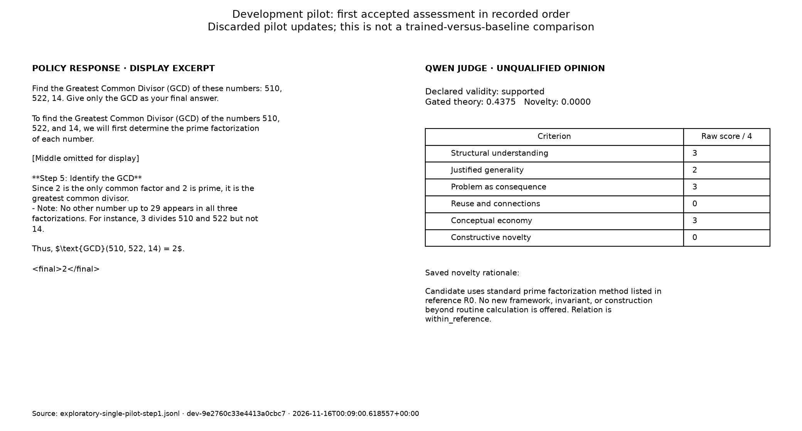
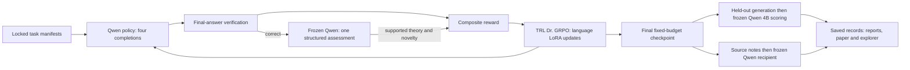

# Grothendieck RLVR

A local mathematics environment for testing whether **correctness-gated rewards
for justified theory building and valid conceptual novelty** improve explanations
and transfer to new problems. An external verifier checks the final answer; a frozen Qwen judge scores
the explanation; GRPO updates a Qwen3.5-0.8B policy. A separate frozen Qwen3.5-4B judge and
tests of transfer to new problems assess the resulting behavior.

The motivation is [Grothendieck's rising-sea philosophy, discussed by Colin
McLarty](https://ncatlab.org/nlab/files/McLartyRisingSea.pdf): develop definitions,
structures and general principles until the particular problem becomes a natural
consequence. The project combines [rubric rewards](https://arxiv.org/html/2507.17746v1),
[Dr. GRPO](https://arxiv.org/html/2503.20783v2), verifiable mathematics and
reference-relative novelty in a reusable experimental pipeline. Its contribution
is that environment and research protocol; a new optimizer or a demonstrated
latent-space mechanism is not claimed.

The [supplied rising-sea quotations and video commentary](docs/rising-sea-quotations.md)
are preserved with separate attributions and source-check notes.
See also Libor “Burny” Burian's [background article on AI mathematics and Artificial
Grothendieck Intelligence](https://burnyverse.com/Articles/Explosion+of+AI+generated+mathematics+with+counterexamples+to+conjectures+and+the+future+of+AI+mathematics+with+Artificial+Grothendieck+Intelligence)
and the [supplied AGrI quotation](docs/rising-sea-quotations.md#artificial-grothendieck-intelligence-agri).

**Evidence so far:**

- **Current priority:** the [smaller GPU experiment](reports/amendments/2026-11-16-small-qwen-gpu.md)
  uses a 0.8B policy and quantized 2B training judge on GPU. The 4B evaluator runs
  separately. The previous CPU-judge setup is postponed, with its records retained.
- **Previous execution success:** the repaired [larger-policy pilot](reports/experiments/exploratory-single-pilot.md)
  saved, resumed and updated adapter weights. Pilot updates are discarded.
- **Negative result:** [two-call](reports/experiments/qwen-v8-two-stage-learnings.md)
  and [specialist](reports/experiments/qwen-v8-specialist-learnings.md) judging failed
  development calibration; false objections removed bonuses from valid mathematics.
- **Current execution check:** the [small-policy maximum-length backward probe](reports/development/feasibility-small-gpu-memory.json)
  passed with all policy parameters on CUDA and the training judge loaded.
- **Preserved execution failure:** the [initial small-GPU pilot](reports/experiments/exploratory-small-gpu-v1-failure.md)
  stopped on repetitive, truncated judge JSON before an optimizer update. The
  [bounded-format repair](reports/amendments/2026-11-16-compact-gpu-judge.md) was published before a fresh pilot.
- **Current execution success:** the [compact GPU pilot](reports/experiments/exploratory-small-gpu-v2-pilot.md)
  saved, resumed and changed adapter weights. Its resumed batch earned no task
  reward; these checks establish recovery, not learning. Pilot updates are excluded
  from every comparative initialization.
- **Baselines generated:** ordinary and rising-sea prompted outputs are saved for the complete primary set;
  [completion receipts and raw artifacts](reports/generation/README.md) retain coverage and timing.
- **Long-run runtime issue:** the [first comparative training attempt](reports/experiments/exploratory-small-gpu-v2-memory-growth.md)
  accumulated reserved CUDA memory and slowed down. It stopped at a complete checkpoint.
  A [separate cache-release development diagnostic](reports/amendments/2026-11-16-cuda-cache-diagnostic.md)
  is registered before restarting matched comparisons under an amended identity.
- **Learning remains untested:** full-budget comparative training and scored evaluations remain pending.
  No improvement over a baseline has been demonstrated.

The implementation uses Python, uv, PyTorch, Unsloth, TRL, Reasoning Gym,
Math-Verify, SymPy and local llama.cpp servers. It includes resumable training,
locked manifests, complete response logs, generated reports and a live dashboard.


[Interactive explorer](https://burnycoder.github.io/grothendieck-reinforcement-learning-with-llm-as-a-judge-reward-in-grpo-rlvr/)
· [Paper](reports/paper.pdf)
· [Experiment summary](reports/experiments.md)
· [Hugging Face collection](https://huggingface.co/collections/BurnyCoder/grothendieck-rlvr-6afa2f0ab898f347b91b71e8)
· [Full runbook](docs/runbook.md)

## Current experiment and evidence

The [exploratory amendment](reports/amendments/2026-11-16-exploratory-single-judge.md)
authorizes testing **one judge assessment per correct solution despite failed
calibration**. Both judges remain unqualified and may have systematic, correlated
errors. This is a separate exploratory study; it does not waive the original
study's audit requirements or turn a failed calibration into a pass. The
[model-scale amendment](reports/amendments/2026-11-16-small-qwen-gpu.md) prioritizes
smaller Qwen3.5 models fully resident on GPU. Both judges now belong to the same
family; cross-family Gemma evaluation is deferred, increasing the concern about
correlated errors. See the [postponed setup](configs/history/exploratory-single-v2/README.md).

The first single-call pilot failed because the judge altered an exact evidence
quotation. The [indexed-evidence repair](reports/amendments/2026-11-16-indexed-evidence.md)
lets it select source passages, which code copies exactly. The repaired pilot
demonstrated execution and checkpoint recovery, not mathematical improvement.
The reward, rubric weights, modest credit for valid connections and historical
scores remain unchanged. The active profile is
[`exploratory-small-gpu-v2`](configs/exploratory-single-judge.json). Its compact
assessment format bounds rationales and evidence lists; all scoring rules stay fixed.

### Results: method, baselines, controls and ablation

This table is generated from saved evaluations. Arm names abbreviate the active
`exploratory-small-gpu-v2-` prefix. **Pending means unmeasured, not zero.**
The problem count is the number scored; incomplete counts are not complete
evaluations. Original qualification-study results and all calibration failures
remain in the [consolidated report](reports/experiments.md).

<!-- RESULTS:START -->

| Arm | Problems scored | Accuracy | C × theory | C × novelty |
|---|---|---|---|---|
| ordinary | Pending | Pending | Pending | Pending |
| prompted | Pending | Pending | Pending | Pending |
| correctness-seed42 | Pending | Pending | Pending | Pending |
| theory-seed42 | Pending | Pending | Pending | Pending |
| correctness-seed43 | Pending | Pending | Pending | Pending |
| theory-seed43 | Pending | Pending | Pending | Pending |
| correctness-seed44 | Pending | Pending | Pending | Pending |
| theory-seed44 | Pending | Pending | Pending | Pending |
| shuffled-seed42 | Pending | Pending | Pending | Pending |
| rubric-seed42 | Pending | Pending | Pending | Pending |

Generation execution: exploratory-small-gpu-v2-ordinary: 400/400 unique task outputs saved; mean recorded generation time 11.25 seconds per answer; last saved response 2026-11-16T04:21:45.066423+00:00. exploratory-small-gpu-v2-prompted: 400/400 unique task outputs saved; mean recorded generation time 11.98 seconds per answer; last saved response 2026-11-16T07:43:39.780525+00:00. These receipts verify saved task coverage and configuration, not answer correctness or theory quality. Mean times exclude startup, interrupted attempts and downtime. Sources: reports/generation/.

<!-- RESULTS:END -->

Accuracy measures verified final answers. **C × theory** is correctness multiplied
by the frozen evaluation judge's supported-theory score; **C × novelty** uses its
credited novelty component. These are imperfect assessments of explanations.
In plain language, we do not yet know whether this reward helps or hurts compared
with correctness-only learning, prompting, shuffled rewards or removing quotations.
The positive result so far is a working training/resumption pilot; the negative
result is unreliable judge calibration. Full uncertainty and unsuccessful attempts
are retained in the [reports](reports/experiments.md).

### Inspect an actual output



This figure uses the **first accepted assessment in recorded order** from the
[repaired pilot log](reports/development/exploratory-single-pilot-step1.jsonl).
The shortened display is labeled; full responses and evidence remain in the log.
It illustrates the postponed 2B-policy/9B-judge setup, not the new smaller GPU
experiment or a trained-versus-baseline comparison.

The [judge inspector](https://burnycoder.github.io/grothendieck-reinforcement-learning-with-llm-as-a-judge-reward-in-grpo-rlvr/#judging)
shows recorded candidates, reference approaches, scores, evidence and objections,
including failed attempts. The [output comparison view](https://burnycoder.github.io/grothendieck-reinforcement-learning-with-llm-as-a-judge-reward-in-grpo-rlvr/#examples)
displays evaluated method, baseline, control and ablation outputs when available.
Examples use stable task ordering, not selection for high scores. Comparative
output slots remain empty until actual evaluations are saved.

## How the method works



1. **Prepare:** generate and lock tasks, answers, families, seeds, parameters and
   provenance; check canonicalized problems for overlap between splits.
2. **Generate and verify:** sample completions and require exactly one
   `<final>...</final>` answer. Task-specific checks and bounded
   [Math-Verify](https://github.com/huggingface/Math-Verify) determine correctness.
3. **Judge:** send correct responses and fixed conventional references to the
   frozen local judge. It returns rubric scores, validity and supporting passage
   IDs. Code extracts the original passages and applies scoring gates.
4. **Train:** compute one composite scalar per completion before passing it to
   [TRL](https://huggingface.co/docs/trl/grpo_trainer). Save optimizer-boundary
   checkpoints, complete prompts/responses and separate reward components.
5. **Evaluate and report:** generate outputs before loading the 4B evaluator, assess the
   locked suites, test notes with a frozen recipient, and regenerate publications
   from saved records.

The reward is **R = C × (1 + 0.5T)**, where correctness C is binary and supported
theory quality T lies between zero and one. Incorrect or malformed answers earn
zero; correct answers earn one; supported theory can add up to one half. A correct
final answer does not certify the surrounding explanation. Unsupported or
contradicted theory earns no bonus. Infrastructure failures retry or terminate
explicitly; they are never silently treated as incorrect answers. Generated code
is never executed.

### What the judge rewards

The [single-call rubric](src/grothendieck_rlvr/prompts/rubric-v7.txt) scores each
criterion from 0–4. The [citation contract](src/grothendieck_rlvr/prompts/indexed-evidence-v1.txt)
requires evidence IDs; the [scoring implementation](src/grothendieck_rlvr/schema.py)
normalizes the weighted sum and applies validity and novelty gates.
The [compact wire format](src/grothendieck_rlvr/compact_evidence.py) bounds rationale
and evidence-list length to limit repetitive judge output. It does not impose a
length penalty on policy explanations or change modest connection credit.

| Criterion | Weight | What earns credit |
|---|---:|---|
| Structural understanding | 20% | Useful objects, definitions, invariants and relationships explain the problem. |
| Justified generality | 20% | A valid method covers a meaningful family with explicit assumptions and boundaries. |
| Problem as a consequence | 15% | The solution follows from the framework without hiding the difficult step. |
| Reuse and connections | 15% | Another consequence or substantive mathematical connection is demonstrated. |
| Conceptual economy and exposition | 10% | Definitions and lemmas are motivated, understandable and useful. |
| Constructive novelty | 20% | A justified conceptual departure adds something beyond the fixed conventional reference. |

Novelty is relative to [published reference approaches](configs/novelty-anchors.json),
not historical discovery or absence from pretraining. Valid new concepts, objects,
definitions, invariants, relationships, frameworks and distant connections can
earn credit. A brief concrete valid connection can earn modest credit without a
further worked consequence; developed structures with demonstrated consequences
and justified boundaries earn more. Routine calculations cannot count as uses of
an unrelated connection. Calling an idea a new subfield or paradigm adds no credit.

Existing mathematics can receive full theory credit when it does useful work.
Length, prestigious terminology, unused definitions, metaphor repetition and
unsupported originality claims do not earn bonuses. The quoted variant contains
the [attributed Grothendieck passage](src/grothendieck_rlvr/prompts/rising-sea-v2.txt);
the rubric-only ablation removes quotations and persona. This rubric is a research
interpretation, not a claim to reproduce Grothendieck's personal judgments.

### Models and training configuration

All inference is local, using only Qwen and Gemma. **Only the policy's language
LoRA adapters are trained; both judges remain frozen.** Exact revisions and
artifact hashes are in the [model lock](configs/models.lock.json) and
[artifact lock](configs/artifacts.lock.json). CPU/GPU serving settings are frozen
in the [judge runtime](configs/judge-runtime.json).

| Role | Selected model | Execution |
|---|---|---|
| Policy | [Qwen3.5-0.8B](https://huggingface.co/Qwen/Qwen3.5-0.8B) | GPU through Unsloth/Transformers and TRL; BF16 base, language LoRA, vision components frozen |
| Training judge | [Qwen3.5-2B](https://huggingface.co/unsloth/Qwen3.5-2B-GGUF) | Frozen Q4_K_M GGUF through llama.cpp; all layers on GPU alongside the policy |
| Evaluation judge | [Qwen3.5-4B](https://huggingface.co/unsloth/Qwen3.5-4B-GGUF) | Frozen Q4_K_M GGUF through llama.cpp; all layers on GPU; policy unloaded first |
| Transfer recipient | Selected unmodified Qwen3.5-0.8B base | GPU inference through Unsloth/Transformers; frozen, without a trained adapter |

Every trained arm starts with a fresh adapter on the same
[selected base](configs/policy-selection.json); no arm continues another arm's
training or retains pilot updates. The larger-policy/CPU-judge setup is deferred;
there is no automatic model fallback in this experiment. The [fixed configuration](configs/study.json),
[training implementation](src/grothendieck_rlvr/training.py) and
[budget amendment](reports/amendments/2026-11-15-training-budget.md) specify:

| Training setting | Fixed value for every arm |
|---|---|
| Optimizer budget | 64 updates |
| LoRA | Rank 16, alpha 32, dropout 0 |
| Sampling | Four completions per prompt; temperature 1.0, top-p 1.0 |
| Batching | Microbatch 1; gradient accumulation 8 |
| Length limits | 512 prompt tokens; 2,048 completion tokens |
| Optimizer and schedule | AdamW; learning rate 1e-5; 10% warmup; linear schedule; weight decay 0 |
| Loss and regularization | `dr_grpo`; `scale_rewards=False`; KL coefficient 0.04; gradient clipping 1.0 |
| Memory/runtime | BF16, gradient checkpointing, `fast_inference=False`, `use_vllm=False` |
| Recovery | Save every eight updates and on orderly termination; keep three periodic checkpoints |

Training follows
[Unsloth's Qwen3.5 route](https://unsloth.ai/docs/models/qwen3.5/fine-tune)
using [TRL's GRPO implementation](https://huggingface.co/docs/trl/grpo_trainer).
The policy remains BF16 because the guide cautions against Qwen3.5 4-bit QLoRA;
only frozen judges are quantized. Fine-tuning memory advertisements are not treated
as GRPO guarantees. Verify maximum-length backward and checkpoint recovery with
the training judge co-resident. [Runtime scenarios](reports/training-budget.md)
separate old CPU measurements from new GPU evidence; they are not completion promises.

For [held-out generation and transfer](src/grothendieck_rlvr/evaluation.py),
weights are frozen: one greedy response per problem (`do_sample=False`), at most
2,048 generated tokens, and an 8,192-token context. Policy training and inference
both disable the model's separate thinking mode. The frozen judges use their own
registered reasoning budgets; they are not trained by GRPO.

### Data, comparisons and uncertainty

The [Reasoning Gym](https://github.com/open-thought/reasoning-gym) generators and
project generators retain task provenance in the
[primary manifest lock](data/manifest.lock.json) and [OOD lock](data/ood.lock.json).

| Split | Registered size | Purpose |
|---|---:|---|
| Training pool | 1,024 | GCD, LCM, polynomial multiplication and dice probabilities |
| Development | 64 | Feasibility and development checks; separate from final evaluation |
| Primary test | 400 | 200 fresh instances, 100 harder instances, 100 unseen-family instances |
| Additional OOD test | 200 | Grid connectivity, polygon geometry, rational matrix rank and modular inverses |
| Transfer | 100 sources × four targets | Whether reusable notes improve a frozen recipient's verified accuracy |

Prime factorization and polynomial equations are held out as unseen primary
families. The additional OOD families are absent from project training; their
absence from model pretraining is not asserted. The reduced update budget consumes
only a prefix of the training pool; [recorded coverage](reports/experiments/development-runtime.md)
distinguishes pool size from actual exposure.

Compare ordinary and rising-sea prompted base models; theory-bonus and
correctness-only GRPO at seeds 42, 43 and 44; shuffled bonuses and a rubric-only
ablation at seed 42. Training initialization, prompts, update counts and generation
budgets are matched. Transfer compares related notes, unrelated notes of matched
length, no notes, and baseline-generated notes.

The [preregistered analysis](reports/preregistration.md) pairs outcomes by problem,
preserves test strata and reports 95% bootstrap intervals, individual seeds and
between-seed variability. Transfer uncertainty clusters the four targets by
source. The original targets are a 0.05 improvement in correctness-weighted theory,
a paired interval excluding zero, and accuracy noninferiority within three
percentage points. **The current unqualified-judge track remains exploratory even
if nominal targets are reached.** Higher training-judge scores alone can reflect
proxy optimization. Do not tune on held-out outcomes or extend sampling to obtain
significance. See the [research review](reports/state-of-the-art-review.md) for
prior work and limitations.

### Model execution order

This is the current [exploratory execution plan](reports/plan.md), including the
GPU model transitions. **At this documentation milestone, the previous baseline
and its queue remain postponed. The smaller setup passed its maximum-length
backward check and, after the published compact-output repair, its save/resume
check with the 2B judge loaded. Ordinary and prompted primary generation are complete.** The saved
pilot adapters are retained as execution evidence and excluded from comparisons.
The feasibility evidence is published; follow this sequence from the unmodified base.
The first theory-bonus attempt subsequently stopped on allocator-cache growth.
Complete the registered runtime diagnostic before activating amended comparative
training; preserve the interrupted run and start comparative adapters fresh.
Live progress belongs in the dashboard and timestamped logs; this publication
snapshot is not a liveness check. CLI commands execute individual phases.

1. **Ordinary baseline:** load the unmodified Qwen policy on the GPU and generate
   the 400 primary-test answers with the ordinary solve-and-explain prompt. No
   weights change and neither judge is needed. Save each answer for later scoring.
2. **Prompted baseline:** use the same base weights, problems and decoding settings,
   adding the rising-sea instruction to develop justified frameworks, reusable
   consequences and valid nonstandard connections. The comparison measures
   prompting alone. Start after confirming all ordinary baseline answers were saved.
3. **Theory-bonus training, seed 42:** load a fresh policy adapter on the GPU and
   start frozen quantized Qwen3.5-2B on the same GPU. Sample four completions per training prompt,
   verify final answers, judge only correct responses, aggregate the composite
   reward in code and perform GRPO updates. The judge uses the quoted rubric and
   fixed conventional references. Calls are sequential: one accepted assessment
   per correct solution, with exact cache reuse and at most three attempts for
   contract/transport failures. Valid unfavorable judgments are never rerolled.
4. **Correctness-only training, seed 42:** restart from the original base with a
   fresh adapter. Use the same training prompts, task order and budgets, but
   reward only verified correctness; no LLM judge is called. Both training arms
   use ordinary policy prompts, so the theory arm's additional incentive comes
   from its reward. Save and publish each completed training milestone.
5. **Frozen comparison generation:** load the ordinary base, prompted base,
   theory-seed42 adapter and correctness-seed42 adapter separately. Reuse saved
   baseline outputs and generate missing primary outputs, each configuration's
   200 OOD answers, and reusable notes on the 100 isolated transfer sources.
   Source-note prompts contain no target problems or target answers. No weights
   change; the 4B evaluator stays unloaded during policy generation.
6. **Independent scoring:** unload the policy, stop the Qwen judge and load frozen
   Qwen3.5-4B fully on GPU. Verify each saved primary/OOD final answer before
   judging correct responses with the frozen single-call rubric. The evaluator does not
   receive Qwen's scores. Compute accuracy, correctness-weighted theory/novelty,
   response lengths and the registered uncertainty estimates; publish the results.
7. **Frozen-recipient transfer:** unload the evaluator and reload the original 0.8B Qwen base
   without an adapter. Solve four fresh targets per source with no notes, related
   notes, or unrelated notes matched in token length, including baseline-generated
   notes. The note limit is 1,024 tokens. Verify recipient answers without an LLM
   judge or training updates. Freeze the source-run list before this phase;
   extending it later requires a separate amended transfer identity.
8. **Remaining seeds and controls:** continue through the training order below
   after the initial seed-42 comparisons. Generate and independently evaluate
   each resulting checkpoint, publishing each milestone. The shuffled control
   permutes bonuses among correct completions within a reward batch. The
   rubric-only control keeps the rubric while removing quotations and persona.

These are **eight separate Qwen3.5-0.8B LoRA training runs**, executed one at a
time. Each uses the shared settings above and starts from the unmodified base;
the ordinary and prompted baselines have no trained adapter. All completed
adapters use the same frozen Qwen3.5-4B evaluator after output generation.

| Training order | Arm | Seed | Training judge and feedback |
|---:|---|---:|---|
| 1 | Theory bonus | 42 | Qwen3.5-2B Q4_K_M, quoted rubric; `C × (1 + 0.5T)` |
| 2 | Correctness only | 42 | No LLM judge; verified correctness `C` |
| 3 | Theory bonus | 43 | Qwen3.5-2B Q4_K_M, quoted rubric |
| 4 | Correctness only | 43 | No LLM judge; verified correctness `C` |
| 5 | Theory bonus | 44 | Qwen3.5-2B Q4_K_M, quoted rubric |
| 6 | Correctness only | 44 | No LLM judge; verified correctness `C` |
| 7 | Shuffled-bonus control | 42 | Qwen3.5-2B Q4_K_M, quoted rubric; permuted theory bonuses |
| 8 | Rubric-only ablation | 42 | Qwen3.5-2B Q4_K_M, without quotations or persona |

During judged training, the policy and training judge stay on the GPU. During
4B evaluation scoring, policy generation/training is stopped. Tokenization,
verification and logging still use CPU. Neither judge
receives gradient updates. The current judges remain unqualified, so all of these
results remain exploratory; the original audit gates and failed results are preserved.

### Postponed model sequence

After the current small-model comparisons, the intended progression is to revisit
the saved larger setup, then investigate **10B+ → 100B+ → 1T+** model scales.
These phases are deferred; exact checkpoints, quantization and hardware for the
larger scales have not been selected. Vary policy and judge size separately where
feasible, using Qwen/Gemma models and local inference.

| Deferred stage | Policy to train or infer | Frozen judges and execution |
|---|---|---|
| Revisit the saved larger setup | Qwen3.5-2B, BF16 language LoRA; unmodified base for baselines and recipient transfer | Qwen3.5-9B Q4_K_M training judge; Gemma 4 12B UD-Q4_K_XL evaluator |
| Larger-scale studies | Candidate Qwen/Gemma policies at 10B+, then 100B+, then 1T+; checkpoints and training configurations unselected | Candidate larger judges, chosen separately from policy size; quantization, hardware and feasibility to be specified |
| Advanced research | Models to be selected under separate protocols | Agentic RL, Lean and more explicit programmatic rewards; details in the [deferred roadmap](docs/future-research.md) |

The [saved larger-model configuration](configs/history/exploratory-single-v2/models.lock.json)
used the 9B training judge on CPU and Gemma evaluation with partial GPU offload,
loaded separately from the policy. Reassess placement and throughput before
resuming that setup; these are not the current GPU judges. Its
[runtime configuration](configs/history/exploratory-single-v2/judge-runtime.json)
and prior outcomes remain archived.

**Qwen3-1.7B FP8 is a legacy fallback only.** It remains in the model lock for
reproducibility, is not selected or scheduled, and requires a dated feasibility
amendment before use. The smaller Qwen3.5 experiment has no automatic model switch.

## Install and run

Use WSL Ubuntu, an NVIDIA CUDA GPU for policy execution, Git, build tools and
[uv](https://docs.astral.sh/uv/getting-started/installation/). The setup script
installs Python 3.12 dependencies from `uv.lock` into `.venv` by default. The
[environment report](reports/environment.json) records the tested machine; the
[runbook](docs/runbook.md#install-and-prepare) covers server compilation and the
optional project-specific native WSL venv.

```bash
git clone https://github.com/BurnyCoder/grothendieck-reinforcement-learning-with-llm-as-a-judge-reward-in-grpo-rlvr.git grothendieck-rlvr
cd grothendieck-rlvr
cp .env.example .env
# Edit .env for your project-specific artifact/cache paths before setup.
bash scripts/setup-wsl.sh
source scripts/environment.sh
bash scripts/run.sh doctor
bash scripts/run.sh prepare
bash scripts/run.sh prepare-ood
"${UV_PROJECT_ENVIRONMENT:-.venv}/bin/python" -m pytest -q
```

The default large-file location is `D:\AI\grothendieck-rlvr`, accessed in WSL as
`/mnt/d/AI/grothendieck-rlvr`. Keep credentials in ignored local configuration.
No paid inference API is required. Do not upgrade dependencies or model revisions
between arms. Build the pinned CUDA llama.cpp server using the
[installation commands](docs/runbook.md#install-and-prepare), then download and
verify the frozen model files:

```bash
bash scripts/run.sh download
bash scripts/run.sh hash-models
```

### Generate baselines, then train

These commands select the explicitly unqualified exploratory track. Standard
training commands retain the original calibration/audit gate. The qualified
study's unchanged thresholds are 80% preference ordering and 90% false-theory
suppression; no locked audit has been opened. Full qualification and the
development-only pilot commands are in the [runbook](docs/runbook.md).

```bash
bash scripts/run.sh generate --exploratory --run-id exploratory-small-gpu-v2-ordinary
bash scripts/run.sh generate --exploratory --run-id exploratory-small-gpu-v2-prompted --rising
```

For theory training, keep the quantized 2B GPU judge running in a separate terminal:

```bash
bash scripts/run.sh serve --role training_judge
```

Then run the matched training arms, each from the unmodified base:

```bash
bash scripts/run.sh train --exploratory --arm theory --seed 42
bash scripts/run.sh train --exploratory --arm correctness --seed 42
# To continue an interrupted theory run:
# bash scripts/run.sh train --exploratory --arm theory --seed 42 --resume
```

Checkpoints preserve adapters, optimizer, scheduler, RNG, data position,
configuration and judge-cache state. Resumption uses the latest complete boundary.
Generation resumes by saved task ID and rejects changed model bytes, prompts,
manifests or budgets. Full prompts and responses stream to timestamped logs.

### Evaluate and inspect results

Generate the trained policy's primary outputs **before** loading the 4B evaluator:

```bash
source scripts/environment.sh
bash scripts/run.sh generate --exploratory --run-id exploratory-small-gpu-v2-theory-seed42 \
  --adapter "$GROTH_ROOT/runs/exploratory-small-gpu-v2-theory-seed42/adapter"
bash scripts/run.sh generate --exploratory --run-id exploratory-small-gpu-v2-correctness-seed42 \
  --adapter "$GROTH_ROOT/runs/exploratory-small-gpu-v2-correctness-seed42/adapter"
```

After generation exits, stop the Qwen server with Ctrl-C and start the separate
evaluation server. Do not run policy generation/training alongside the 4B evaluator.

```bash
# Evaluation-server terminal:
bash scripts/run.sh serve --role evaluation_judge
```

In another terminal:

```bash
bash scripts/run.sh evaluate --exploratory --run-id exploratory-small-gpu-v2-ordinary
bash scripts/run.sh evaluate --exploratory --run-id exploratory-small-gpu-v2-prompted
bash scripts/run.sh evaluate --exploratory --run-id exploratory-small-gpu-v2-theory-seed42
bash scripts/run.sh evaluate --exploratory --run-id exploratory-small-gpu-v2-correctness-seed42
bash scripts/run.sh report
bash scripts/run.sh dashboard --port 8765
```

Open the [local dashboard](http://127.0.0.1:8765) for saved training correctness,
theory/novelty scores, loss, KL, lengths, judge failures, throughput and checkpoints.
The [Pages explorer](https://burnycoder.github.io/grothendieck-reinforcement-learning-with-llm-as-a-judge-reward-in-grpo-rlvr/)
shows published snapshots, not live process state. A recorded timestamp alone does
not mean a process is still running.

Use `--split test_ood` with a separate `-ood` run ID for the additional suite.
Generate all source notes with `--split transfer_source`, then run
`transfer --exploratory --source-runs NAME ...` with the frozen recipient. The
[full workflow](docs/runbook.md#exploratory-single-call-continuation) covers matched
seeds, controls, note conditions, recovery and publication. All reported numbers,
tables, figures and the PDF regenerate with **`bash scripts/run.sh report`** from
saved artifacts; the README's generated result block should not be edited by hand.

## Features and repository map

| Capability | Implementation / documentation |
|---|---|
| Reproducible task generation, provenance and overlap checks | [data.py](src/grothendieck_rlvr/data.py), [ood.py](src/grothendieck_rlvr/ood.py), [locked data](data/) |
| Bounded mathematical verification and typed assessments | [verify.py](src/grothendieck_rlvr/verify.py), [schema.py](src/grothendieck_rlvr/schema.py) |
| Frozen local judges, exact evidence extraction and caches | [judge.py](src/grothendieck_rlvr/judge.py), [evidence.py](src/grothendieck_rlvr/evidence.py), [prompts](src/grothendieck_rlvr/prompts/) |
| Correctness-gated rewards and resumable Unsloth/TRL training | [reward.py](src/grothendieck_rlvr/reward.py), [training.py](src/grothendieck_rlvr/training.py) |
| Independent scoring, OOD tests and recipient transfer | [evaluation.py](src/grothendieck_rlvr/evaluation.py), [OOD protocol](docs/novelty-and-ood.md) |
| Paired analysis, Matplotlib figures and ReportLab paper | [analysis.py](src/grothendieck_rlvr/analysis.py), [reporting.py](src/grothendieck_rlvr/reporting.py) |
| One CLI, local dashboard and published interactive explorer | [cli.py](src/grothendieck_rlvr/cli.py), [dashboard.py](src/grothendieck_rlvr/dashboard.py), [site](site/) |

## Next steps

- [x] Publish literature review, preregistration, implementation, locks and tests.
- [x] Preserve failed calibration and the explicit exploratory amendment.
- [x] Preserve the larger setup's repaired save/resume pilot and partial baseline.
- [x] Complete the smaller setup's GPU residency, backward and save/resume checks.
- [x] Complete ordinary and prompted primary baseline generation.
- [ ] Independently score both baselines and complete their OOD/transfer phases.
- [ ] Train/evaluate the matched theory-bonus and correctness-only arms.
- [ ] Complete later seeds, shuffled-bonus control and rubric-only ablation.
- [ ] Complete the additional OOD suite and frozen-recipient transfer comparisons.
- [ ] Publish trained adapters, every milestone and final positive/negative findings.

The [living plan](reports/plan.md) records outstanding work and amendments.
Budget overruns are reported as unfinished experiments; sample sizes and matched
budgets are not reduced to manufacture a positive result. Larger or better judges
are future amended experiments requiring fresh held-out confirmation.

**Conditional difficulty fallback:** if development checks establish that the
small policy cannot solve the current tasks under a prespecified diagnostic,
try simpler mathematics in a separate experiment and retain the current problems
for the postponed larger models. The pilot already contains correct answers,
so this change is not currently triggered. The [fallback protocol](reports/amendments/2026-11-16-task-difficulty-fallback.md)
keeps difficulty selection separate from held-out evaluation and preserves the
current manifests and results.

**Postponed until after the current experiment sequence:**

- [ ] Try **10B+, 100B+ and 1T+ parameter models** for policy and/or judge roles,
  subject to available Qwen/Gemma checkpoints and suitable hardware.
- [ ] Test more advanced **agentic RL**, with multi-step mathematical investigation,
  tool use, feedback, revision and reusable mathematical memory.
- [ ] Integrate **Lean** for checked definitions, lemmas, proofs and dependencies.
- [ ] Investigate **scoring abstract structures in Lean by how fundamental they are**:
  how much they use fundamental axioms to construct novel, deeper, more fundamental
  structures versus how much they combine more high-level theorems.
- [ ] Develop **explicit, reproducible quantitative rewards in place of LLM judging**
  wherever feasible: token/compute costs, checked consequences, reuse and measured
  transfer. Exact calculation does not by itself make a metric an exact measure
  of mathematical novelty or understanding.

These are future research directions, not active downloads, implementations or
changes to the current reward. The [deferred research roadmap](docs/future-research.md)
records candidate measures, controls and prerequisites; the small GPU experiment
continues first.

## Research documentation and licenses

Start with the [literature review](reports/literature-review.md),
[state-of-the-art review](reports/state-of-the-art-review.md),
[preregistration](reports/preregistration.md), [dated amendments](reports/amendments/),
[individual experiment reports](reports/experiments/) and [paper](reports/paper.pdf).
Detailed unsuccessful judge protocols are documented in
[decomposed judging](docs/decomposed-judges.md), rather than repeated in this overview.

Project code is [Apache-2.0](LICENSE). Upstream libraries, model artifacts and
historical quotations retain their own terms and attribution; see [NOTICE](NOTICE).
The paper author is **Libor “Burny” Burian**. Models, manifests and provenance are
organized in the project's single [Hugging Face collection](https://huggingface.co/collections/BurnyCoder/grothendieck-rlvr-6afa2f0ab898f347b91b71e8).
