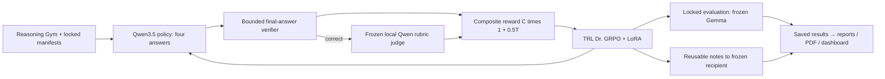

# Grothendieck RLVR

A local mathematics environment for testing whether correctness-gated rubric
rewards encourage useful, justified theory building. A frozen Qwen judge scores
structures, generality and reusable consequences; an external verifier checks
the final answer. GRPO trains Qwen3.5 language adapters. A separate frozen Gemma
judge and recipient-transfer tests assess behavior.

**Status: preregistered design; implementation and experiments pending. No
empirical improvement or latent-space steering has been demonstrated.**

The motivation is [Grothendieck's rising-sea philosophy, discussed by Colin
McLarty](https://ncatlab.org/nlab/files/McLartyRisingSea.pdf): develop concepts
until particular problems become natural consequences. The rubric is an explicit
research interpretation, not a simulation of his personal judgments.

## Research protocol

Read the [literature review](reports/state-of-the-art-review.md),
[preregistration](reports/preregistration.md), and [implementation status](reports/plan.md).
We reuse [Reasoning Gym](https://github.com/open-thought/reasoning-gym),
[Math-Verify](https://github.com/huggingface/Math-Verify),
[TRL GRPO](https://huggingface.co/docs/trl/grpo_trainer), and
[Unsloth's Qwen3.5 route](https://unsloth.ai/docs/models/qwen3.5/fine-tune).
The design builds on [rubric RL](https://arxiv.org/html/2507.17746v1) and
[Dr. GRPO](https://arxiv.org/html/2503.20783v2); it does not introduce an optimizer.

Reward is `C * (1 + 0.5*T)`: wrong/invalid answers receive zero, correct answers
receive one, and supported useful theory can add at most one half. A correct
answer does not certify its explanation. Judge errors are not ground truth.
Unsupported or contradicted theory earns no bonus. Length and terminology alone
earn no bonus. Infrastructure failures stop or retry explicitly.

## Models and runtime

Only local Qwen and Gemma models are permitted. Preferred policy:
[Qwen3.5-2B](https://huggingface.co/Qwen/Qwen3.5-2B), BF16 LoRA.
Training judge: [Qwen3.5-9B Q4_K_M](https://huggingface.co/unsloth/Qwen3.5-9B-GGUF),
CPU. Evaluation judge: [Gemma 4 12B UD-Q4_K_XL](https://huggingface.co/unsloth/gemma-4-12b-it-GGUF),
loaded separately. Qwen3-1.7B FP8 is a documented-feasibility-failure fallback
only. Fine-tuning memory advertisements do not guarantee GRPO feasibility.

Target runtime is WSL Ubuntu, Python 3.12 and uv, with a project-local `.venv`.
Large caches and run artifacts belong under `D:\AI\grothendieck-rlvr`
(`/mnt/d/AI/grothendieck-rlvr`). Exact installation and CLI instructions will be
added with tested code before model inference. No paid API services are used.

## Planned comparisons and reporting

Compare ordinary/prompted unmodified policy, correctness-only GRPO, theory-bonus
GRPO, shuffled bonuses and a rubric-only ablation. The main trained pair uses
three seeds. Locked evaluation distinguishes fresh instances, harder parameters,
and unseen families; transfer measures whether notes help a frozen recipient.

Result tables are pending; missing results will never be represented as zeros.
All measured tables and plots will be generated from saved artifacts. The
dashboard will show correctness, theory, losses, KL, lengths, throughput and
checkpoint state. The GitHub Pages explorer will contain published snapshots,
confidence intervals and output comparisons.

## Reproducibility and next steps

The initial public preregistration precedes model inference. Implementation,
tests and model/data locks must be published before calibration and feasibility.
Both judge audits must pass before long training. Every run will preserve its
configuration, prompts, complete outputs, checkpoints and failure records.
See the checklist in [reports/plan.md](reports/plan.md) for outstanding work.

New code will use Apache-2.0; upstream libraries and model artifacts retain their
own licenses. The paper author is Libor “Burny” Burian.
