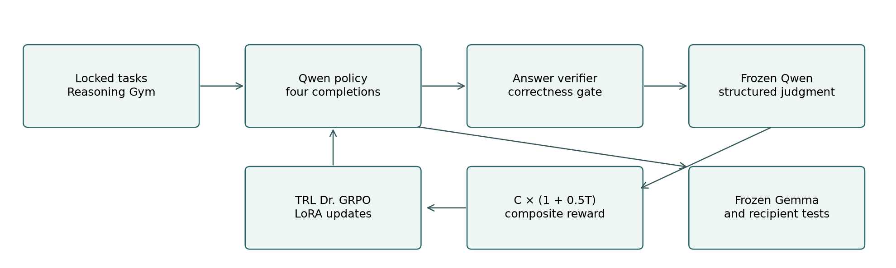
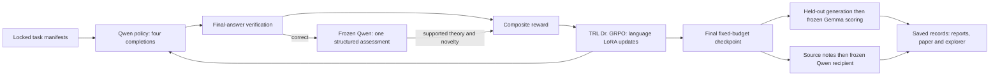

# Grothendieck RLVR

A local mathematics environment for testing whether **correctness-gated rewards
for justified theory building and valid conceptual novelty** improve explanations
and transfer to new problems. An external verifier checks the final answer; a frozen Qwen judge scores
the explanation; GRPO updates a Qwen3.5 policy. A separate frozen Gemma judge and
tests of transfer to new problems assess the resulting behavior.

The motivation is [Grothendieck's rising-sea philosophy, discussed by Colin
McLarty](https://ncatlab.org/nlab/files/McLartyRisingSea.pdf): develop definitions,
structures and general principles until the particular problem becomes a natural
consequence. The project combines [rubric rewards](https://arxiv.org/html/2507.17746v1),
[Dr. GRPO](https://arxiv.org/html/2503.20783v2), verifiable mathematics and
reference-relative novelty in a reusable experimental pipeline. Its contribution
is that environment and research protocol; a new optimizer or a demonstrated
latent-space mechanism is not claimed.

**Evidence so far:**

- **Execution success:** the repaired [development pilot](reports/experiments/exploratory-single-pilot.md)
  saved, resumed and updated adapter weights. Pilot updates are discarded.
- **Negative result:** [two-call](reports/experiments/qwen-v8-two-stage-learnings.md)
  and [specialist](reports/experiments/qwen-v8-specialist-learnings.md) judging failed
  development calibration; false objections removed bonuses from valid mathematics.
- **Learning remains untested:** baseline generation has started. Full comparative
  training and scored evaluations remain pending at this publication milestone.
  No improvement over a baseline has been demonstrated.

The implementation uses Python, uv, PyTorch, Unsloth, TRL, Reasoning Gym,
Math-Verify, SymPy and local llama.cpp servers. It includes resumable training,
locked manifests, complete response logs, generated reports and a live dashboard.



[Interactive explorer](https://burnycoder.github.io/grothendieck-reinforcement-learning-with-llm-as-a-judge-reward-in-grpo-rlvr/)
· [Paper](reports/paper.pdf)
· [Experiment summary](reports/experiments.md)
· [Hugging Face collection](https://huggingface.co/collections/BurnyCoder/grothendieck-rlvr-6afa2f0ab898f347b91b71e8)
· [Full runbook](docs/runbook.md)

## Current experiment and evidence

The [exploratory amendment](reports/amendments/2026-11-16-exploratory-single-judge.md)
authorizes testing **one judge assessment per correct solution despite failed
calibration**. Both judges remain unqualified and may have systematic, correlated
errors. This is a separate exploratory study; it does not waive the original
study's audit requirements or turn a failed calibration into a pass.

The first single-call pilot failed because the judge altered an exact evidence
quotation. The [indexed-evidence repair](reports/amendments/2026-11-16-indexed-evidence.md)
lets it select source passages, which code copies exactly. The repaired pilot
demonstrated execution and checkpoint recovery, not mathematical improvement.
The reward, rubric weights, modest credit for valid connections and historical
scores remain unchanged. The active profile is
[`exploratory-single-v2`](configs/exploratory-single-judge.json).

### Results: method, baselines, controls and ablation

This table is generated from saved evaluations. Arm names abbreviate the active
`exploratory-single-v2-` prefix. **Pending means unmeasured, not zero.**
The problem count is the number scored; incomplete counts are not complete
evaluations. Original qualification-study results and all calibration failures
remain in the [consolidated report](reports/experiments.md).

<!-- RESULTS:START -->

| Arm | Problems scored | Accuracy | C × theory | C × novelty |
|---|---|---|---|---|
| ordinary | Pending | Pending | Pending | Pending |
| prompted | Pending | Pending | Pending | Pending |
| correctness-seed42 | Pending | Pending | Pending | Pending |
| theory-seed42 | Pending | Pending | Pending | Pending |
| correctness-seed43 | Pending | Pending | Pending | Pending |
| theory-seed43 | Pending | Pending | Pending | Pending |
| correctness-seed44 | Pending | Pending | Pending | Pending |
| theory-seed44 | Pending | Pending | Pending | Pending |
| shuffled-seed42 | Pending | Pending | Pending | Pending |
| rubric-seed42 | Pending | Pending | Pending | Pending |

<!-- RESULTS:END -->

Accuracy measures verified final answers. **C × theory** is correctness multiplied
by the frozen evaluation judge's supported-theory score; **C × novelty** uses its
credited novelty component. These are imperfect assessments of explanations.
In plain language, we do not yet know whether this reward helps or hurts compared
with correctness-only learning, prompting, shuffled rewards or removing quotations.
The positive result so far is a working training/resumption pilot; the negative
result is unreliable judge calibration. Full uncertainty and unsuccessful attempts
are retained in the [reports](reports/experiments.md).

### Inspect an actual output


This figure uses the **first accepted assessment in recorded order** from the
[repaired pilot log](reports/development/exploratory-single-pilot-step1.jsonl).
The shortened display is labeled; full responses and evidence remain in the log.
It is a development illustration, not a trained-versus-baseline comparison.

The [judge inspector](https://burnycoder.github.io/grothendieck-reinforcement-learning-with-llm-as-a-judge-reward-in-grpo-rlvr/#judging)
shows recorded candidates, reference approaches, scores, evidence and objections,
including failed attempts. The [output comparison view](https://burnycoder.github.io/grothendieck-reinforcement-learning-with-llm-as-a-judge-reward-in-grpo-rlvr/#examples)
displays evaluated method, baseline, control and ablation outputs when available.
Examples use stable task ordering, not selection for high scores. Comparative
output slots remain empty until actual evaluations are saved.

## How the method works



1. **Prepare:** generate and lock tasks, answers, families, seeds, parameters and
   provenance; check canonicalized problems for overlap between splits.
2. **Generate and verify:** sample completions and require exactly one
   `<final>...</final>` answer. Task-specific checks and bounded
   [Math-Verify](https://github.com/huggingface/Math-Verify) determine correctness.
3. **Judge:** send correct responses and fixed conventional references to the
   frozen local judge. It returns rubric scores, validity and supporting passage
   IDs. Code extracts the original passages and applies scoring gates.
4. **Train:** compute one composite scalar per completion before passing it to
   [TRL](https://huggingface.co/docs/trl/grpo_trainer). Save optimizer-boundary
   checkpoints, complete prompts/responses and separate reward components.
5. **Evaluate and report:** generate outputs before loading Gemma, assess the
   locked suites, test notes with a frozen recipient, and regenerate publications
   from saved records.

The reward is **R = C × (1 + 0.5T)**, where correctness C is binary and supported
theory quality T lies between zero and one. Incorrect or malformed answers earn
zero; correct answers earn one; supported theory can add up to one half. A correct
final answer does not certify the surrounding explanation. Unsupported or
contradicted theory earns no bonus. Infrastructure failures retry or terminate
explicitly; they are never silently treated as incorrect answers. Generated code
is never executed.

### What the judge rewards

The [single-call rubric](src/grothendieck_rlvr/prompts/rubric-v7.txt) scores each
criterion from 0–4. The [citation contract](src/grothendieck_rlvr/prompts/indexed-evidence-v1.txt)
requires evidence IDs; the [scoring implementation](src/grothendieck_rlvr/schema.py)
normalizes the weighted sum and applies validity and novelty gates.

| Criterion | Weight | What earns credit |
|---|---:|---|
| Structural understanding | 20% | Useful objects, definitions, invariants and relationships explain the problem. |
| Justified generality | 20% | A valid method covers a meaningful family with explicit assumptions and boundaries. |
| Problem as a consequence | 15% | The solution follows from the framework without hiding the difficult step. |
| Reuse and connections | 15% | Another consequence or substantive mathematical connection is demonstrated. |
| Conceptual economy and exposition | 10% | Definitions and lemmas are motivated, understandable and useful. |
| Constructive novelty | 20% | A justified conceptual departure adds something beyond the fixed conventional reference. |

Novelty is relative to [published reference approaches](configs/novelty-anchors.json),
not historical discovery or absence from pretraining. Valid new concepts, objects,
definitions, invariants, relationships, frameworks and distant connections can
earn credit. A brief concrete valid connection can earn modest credit without a
further worked consequence; developed structures with demonstrated consequences
and justified boundaries earn more. Routine calculations cannot count as uses of
an unrelated connection. Calling an idea a new subfield or paradigm adds no credit.

Existing mathematics can receive full theory credit when it does useful work.
Length, prestigious terminology, unused definitions, metaphor repetition and
unsupported originality claims do not earn bonuses. The quoted variant contains
the [attributed Grothendieck passage](src/grothendieck_rlvr/prompts/rising-sea-v2.txt);
the rubric-only ablation removes quotations and persona. This rubric is a research
interpretation, not a claim to reproduce Grothendieck's personal judgments.

### Models and training configuration

All inference is local, using only Qwen and Gemma. Exact revisions and artifact
hashes are in the [model lock](configs/models.lock.json) and
[artifact lock](configs/artifacts.lock.json).

| Role | Selected model | Execution |
|---|---|---|
| Policy | [Qwen3.5-2B](https://huggingface.co/Qwen/Qwen3.5-2B) | BF16 language LoRA; vision components frozen |
| Training judge | [Qwen3.5-9B](https://huggingface.co/unsloth/Qwen3.5-9B-GGUF) | Frozen Q4_K_M GGUF on CPU |
| Evaluation judge | [Gemma 4 12B](https://huggingface.co/unsloth/gemma-4-12b-it-GGUF) | Frozen UD-Q4_K_XL GGUF; GPU offload after policy generation |
| Transfer recipient | Selected unmodified Qwen3.5-2B base | Frozen throughout recipient evaluation |

Every trained arm starts from the same [selected base](configs/policy-selection.json).
Qwen3-1.7B remains a documented-feasibility-failure fallback; it is not selected.
The [fixed settings](configs/study.json) use LoRA rank 16, alpha 32, dropout 0,
four completions per prompt, microbatch 1, gradient accumulation 8, learning rate
1e-5, 10% warmup, completion limit 2,048, `dr_grpo`, `scale_rewards=False` and
KL coefficient 0.04. The [budget amendment](reports/amendments/2026-11-15-training-budget.md)
sets **64 updates per arm**. Training follows
[Unsloth's Qwen3.5 route](https://unsloth.ai/docs/models/qwen3.5/fine-tune)
with `fast_inference=False`; fine-tuning memory advertisements are not treated as
GRPO guarantees. Measured [runtime scenarios](reports/training-budget.md) are
estimates, not completion promises.

### Data, comparisons and uncertainty

The [Reasoning Gym](https://github.com/open-thought/reasoning-gym) generators and
project generators retain task provenance in the
[primary manifest lock](data/manifest.lock.json) and [OOD lock](data/ood.lock.json).

| Split | Registered size | Purpose |
|---|---:|---|
| Training pool | 1,024 | GCD, LCM, polynomial multiplication and dice probabilities |
| Development | 64 | Feasibility and development checks; separate from final evaluation |
| Primary test | 400 | 200 fresh instances, 100 harder instances, 100 unseen-family instances |
| Additional OOD test | 200 | Grid connectivity, polygon geometry, rational matrix rank and modular inverses |
| Transfer | 100 sources × four targets | Whether reusable notes improve a frozen recipient's verified accuracy |

Prime factorization and polynomial equations are held out as unseen primary
families. The additional OOD families are absent from project training; their
absence from model pretraining is not asserted. The reduced update budget consumes
only a prefix of the training pool; [recorded coverage](reports/experiments/development-runtime.md)
distinguishes pool size from actual exposure.

Compare ordinary and rising-sea prompted base models; theory-bonus and
correctness-only GRPO at seeds 42, 43 and 44; shuffled bonuses and a rubric-only
ablation at seed 42. Training initialization, prompts, update counts and generation
budgets are matched. Transfer compares related notes, unrelated notes of matched
length, no notes, and baseline-generated notes.

The [preregistered analysis](reports/preregistration.md) pairs outcomes by problem,
preserves test strata and reports 95% bootstrap intervals, individual seeds and
between-seed variability. Transfer uncertainty clusters the four targets by
source. The original targets are a 0.05 improvement in correctness-weighted theory,
a paired interval excluding zero, and accuracy noninferiority within three
percentage points. **The current unqualified-judge track remains exploratory even
if nominal targets are reached.** Higher training-judge scores alone can reflect
proxy optimization. Do not tune on held-out outcomes or extend sampling to obtain
significance. See the [research review](reports/state-of-the-art-review.md) for
prior work and limitations.

## Install and run

Use WSL Ubuntu, an NVIDIA CUDA GPU for policy execution, Git, build tools and
[uv](https://docs.astral.sh/uv/getting-started/installation/). The setup script
installs Python 3.12 dependencies from `uv.lock` into `.venv` by default. The
[environment report](reports/environment.json) records the tested machine; the
[runbook](docs/runbook.md#install-and-prepare) covers server compilation and the
optional project-specific native WSL venv.

```bash
git clone https://github.com/BurnyCoder/grothendieck-reinforcement-learning-with-llm-as-a-judge-reward-in-grpo-rlvr.git grothendieck-rlvr
cd grothendieck-rlvr
cp .env.example .env
# Edit .env for your project-specific artifact/cache paths before setup.
bash scripts/setup-wsl.sh
source scripts/environment.sh
bash scripts/run.sh doctor
bash scripts/run.sh prepare
bash scripts/run.sh prepare-ood
"${UV_PROJECT_ENVIRONMENT:-.venv}/bin/python" -m pytest -q
```

The default large-file location is `D:\AI\grothendieck-rlvr`, accessed in WSL as
`/mnt/d/AI/grothendieck-rlvr`. Keep credentials in ignored local configuration.
No paid inference API is required. Do not upgrade dependencies or model revisions
between arms. Build the pinned CPU and CUDA llama.cpp servers using the
[installation commands](docs/runbook.md#install-and-prepare), then download and
verify the frozen model files:

```bash
bash scripts/run.sh download
bash scripts/run.sh hash-models
```

### Generate baselines, then train

These commands select the explicitly unqualified exploratory track. Standard
training commands retain the original calibration/audit gate. The qualified
study's unchanged thresholds are 80% preference ordering and 90% false-theory
suppression; no locked audit has been opened. Full qualification and the
development-only pilot commands are in the [runbook](docs/runbook.md).

```bash
bash scripts/run.sh generate --exploratory --run-id exploratory-single-v2-ordinary
bash scripts/run.sh generate --exploratory --run-id exploratory-single-v2-prompted --rising
```

For theory training, keep the CPU judge running in a separate terminal:

```bash
bash scripts/run.sh serve --role training_judge
```

Then run the matched training arms, each from the unmodified base:

```bash
bash scripts/run.sh train --exploratory --arm theory --seed 42
bash scripts/run.sh train --exploratory --arm correctness --seed 42
# To continue an interrupted theory run:
# bash scripts/run.sh train --exploratory --arm theory --seed 42 --resume
```

Checkpoints preserve adapters, optimizer, scheduler, RNG, data position,
configuration and judge-cache state. Resumption uses the latest complete boundary.
Generation resumes by saved task ID and rejects changed model bytes, prompts,
manifests or budgets. Full prompts and responses stream to timestamped logs.

### Evaluate and inspect results

Generate the trained policy's primary outputs **before** loading Gemma:

```bash
source scripts/environment.sh
bash scripts/run.sh generate --exploratory --run-id exploratory-single-v2-theory-seed42 \
  --adapter "$GROTH_ROOT/runs/exploratory-single-v2-theory-seed42/adapter"
```

After generation exits, stop the Qwen server with Ctrl-C and start the separate
evaluation server. Do not run GPU policy generation/training alongside Gemma.

```bash
# Evaluation-server terminal:
bash scripts/run.sh serve --role evaluation_judge
```

In another terminal:

```bash
bash scripts/run.sh evaluate --exploratory --run-id exploratory-single-v2-ordinary
bash scripts/run.sh evaluate --exploratory --run-id exploratory-single-v2-prompted
bash scripts/run.sh evaluate --exploratory --run-id exploratory-single-v2-theory-seed42
bash scripts/run.sh report
bash scripts/run.sh dashboard --port 8765
```

Open the [local dashboard](http://127.0.0.1:8765) for saved training correctness,
theory/novelty scores, loss, KL, lengths, judge failures, throughput and checkpoints.
The [Pages explorer](https://burnycoder.github.io/grothendieck-reinforcement-learning-with-llm-as-a-judge-reward-in-grpo-rlvr/)
shows published snapshots, not live process state. A recorded timestamp alone does
not mean a process is still running.

Use `--split test_ood` with a separate `-ood` run ID for the additional suite.
Generate all source notes with `--split transfer_source`, then run
`transfer --exploratory --source-runs NAME ...` with the frozen recipient. The
[full workflow](docs/runbook.md#exploratory-single-call-continuation) covers matched
seeds, controls, note conditions, recovery and publication. All reported numbers,
tables, figures and the PDF regenerate with **`bash scripts/run.sh report`** from
saved artifacts; the README's generated result block should not be edited by hand.

## Features and repository map

| Capability | Implementation / documentation |
|---|---|
| Reproducible task generation, provenance and overlap checks | [data.py](src/grothendieck_rlvr/data.py), [ood.py](src/grothendieck_rlvr/ood.py), [locked data](data/) |
| Bounded mathematical verification and typed assessments | [verify.py](src/grothendieck_rlvr/verify.py), [schema.py](src/grothendieck_rlvr/schema.py) |
| Frozen local judges, exact evidence extraction and caches | [judge.py](src/grothendieck_rlvr/judge.py), [evidence.py](src/grothendieck_rlvr/evidence.py), [prompts](src/grothendieck_rlvr/prompts/) |
| Correctness-gated rewards and resumable Unsloth/TRL training | [reward.py](src/grothendieck_rlvr/reward.py), [training.py](src/grothendieck_rlvr/training.py) |
| Independent scoring, OOD tests and recipient transfer | [evaluation.py](src/grothendieck_rlvr/evaluation.py), [OOD protocol](docs/novelty-and-ood.md) |
| Paired analysis, Matplotlib figures and ReportLab paper | [analysis.py](src/grothendieck_rlvr/analysis.py), [reporting.py](src/grothendieck_rlvr/reporting.py) |
| One CLI, local dashboard and published interactive explorer | [cli.py](src/grothendieck_rlvr/cli.py), [dashboard.py](src/grothendieck_rlvr/dashboard.py), [site](site/) |

## Next steps

- [x] Publish literature review, preregistration, implementation, locks and tests.
- [x] Preserve failed calibration and the explicit exploratory amendment.
- [x] Complete the repaired development save/resume pilot; discard its updates.
- [ ] Complete ordinary and prompted baseline generation and independent scoring.
- [ ] Train/evaluate the matched theory-bonus and correctness-only arms.
- [ ] Complete later seeds, shuffled-bonus control and rubric-only ablation.
- [ ] Complete the additional OOD suite and frozen-recipient transfer comparisons.
- [ ] Publish trained adapters, every milestone and final positive/negative findings.

The [living plan](reports/plan.md) records outstanding work and amendments.
Budget overruns are reported as unfinished experiments; sample sizes and matched
budgets are not reduced to manufacture a positive result. Larger or better judges
are future amended experiments requiring fresh held-out confirmation.

## Research documentation and licenses

Start with the [literature review](reports/literature-review.md),
[state-of-the-art review](reports/state-of-the-art-review.md),
[preregistration](reports/preregistration.md), [dated amendments](reports/amendments/),
[individual experiment reports](reports/experiments/) and [paper](reports/paper.pdf).
Detailed unsuccessful judge protocols are documented in
[decomposed judging](docs/decomposed-judges.md), rather than repeated in this overview.

Project code is [Apache-2.0](LICENSE). Upstream libraries, model artifacts and
historical quotations retain their own terms and attribution; see [NOTICE](NOTICE).
The paper author is **Libor “Burny” Burian**. Models, manifests and provenance are
organized in the project's single [Hugging Face collection](https://huggingface.co/collections/BurnyCoder/grothendieck-rlvr-6afa2f0ab898f347b91b71e8).
