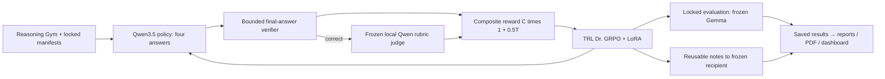

# Grothendieck RLVR

A local mathematics environment for testing whether correctness-gated rubric
rewards encourage useful, justified theory building and **valid conceptual novelty**.
A frozen Qwen judge scores structures, generality, reusable consequences and
useful departures from conventional approaches; an external verifier checks
the final answer. GRPO trains Qwen3.5 language adapters. A separate frozen Gemma
judge, held-out mathematical families and recipient-transfer tests assess behavior.
New definitions, invariants, frameworks and connections to distant mathematics
earn additional credit when they are justified and do mathematical work.
Brief valid connections can earn modest novelty credit; developed, reusable
frameworks can earn more, even when they use established mathematics.

**Status: pipeline implemented; Gemma and Qwen development novelty calibrations failed.
Long training remains blocked by the registered calibration gate. No empirical
improvement or latent-space steering has been demonstrated.**

The motivation is [Grothendieck's rising-sea philosophy, discussed by Colin
McLarty](https://ncatlab.org/nlab/files/McLartyRisingSea.pdf): develop concepts
until particular problems become natural consequences. The rubric is an explicit
research interpretation, not a simulation of his personal judgments.

## Research protocol

Read the [literature review](reports/literature-review.md),
[preregistration](reports/preregistration.md),
[novelty and OOD amendment](reports/amendments/2026-11-15-valid-novelty-and-ood.md),
and [implementation status](reports/plan.md).
We reuse [Reasoning Gym](https://github.com/open-thought/reasoning-gym),
[Math-Verify](https://github.com/huggingface/Math-Verify),
[TRL GRPO](https://huggingface.co/docs/trl/grpo_trainer), and
[Unsloth's Qwen3.5 route](https://unsloth.ai/docs/models/qwen3.5/fine-tune).
The design builds on [rubric RL](https://arxiv.org/html/2507.17746v1) and
[Dr. GRPO](https://arxiv.org/html/2503.20783v2); it does not introduce an optimizer.

Reward is `C * (1 + 0.5*T)`: wrong/invalid answers receive zero, correct answers
receive one, and supported useful theory can add at most one half. A correct
answer does not certify its explanation. Judge errors are not ground truth.
Unsupported or contradicted theory earns no bonus. Length and terminology alone
earn no bonus. Infrastructure failures stop or retry explicitly.

## What the judge rewards

The versioned [judge rubric](src/grothendieck_rlvr/prompts/rubric-v7.txt) scores
each criterion from 0 to 4. Code applies validity and novelty-eligibility gates,
then combines the normalized scores with these weights:

| Criterion | Weight | What earns credit |
|---|---:|---|
| Structural understanding | 20% | Useful objects, definitions, invariants and relationships explain the problem. |
| Justified generality | 20% | A valid method covers a meaningful family with clear assumptions. |
| Problem as a consequence | 15% | The solution follows from the framework without hiding the difficult step. |
| Reuse and connections | 15% | Another consequence or substantive mathematical connection is demonstrated. |
| Conceptual economy and exposition | 10% | Motivated definitions and lemmas make the explanation understandable. |
| Constructive novelty | 20% | A valid conceptual departure beyond the fixed reference; brief concrete connections earn modest credit, and developed frameworks earn more. |

Novelty can take the form of a concept, object, definition, invariant,
relationship, theory, framework, way of thinking, or connection. A proposed
subfield or paradigm earns credit for the mathematics actually developed,
not its name. The highest novelty score requires a reusable framework that
organizes a meaningful family, demonstrates consequences and states boundaries.
More distant connections are welcome when the bridge is established explicitly.
Cosmetic renaming, exotic terminology and unsupported originality claims score zero.
Standard correctness proofs, routine parameter substitutions and equivalent
descriptions of a listed method also receive zero novelty credit. They can
still score highly for justified theory. Development judgments overcredited
conventional proofs as novel, while some Qwen judgments incorrectly withheld
all theory credit from conventional generalizations. The novelty reward is
implemented but not validated. The [development history](reports/plan.md) and
[Gemma failure analysis](reports/experiments/gemma-v4-learnings.md) retain these
negative findings. The [bounded-reasoning attempt](reports/experiments/qwen-reasoning-v4-learnings.md)
also failed under the same v4 rubric, cases and thresholds. It did not establish
a repair of novelty discrimination.
The [first v5 attempt](reports/experiments/qwen-v5-contract-learnings.md)
terminated after repeated disagreement between a within-reference declaration
and a positive novelty score. Its completed contrasts do not constitute a pass.
The [v6 attempt](reports/experiments/qwen-v6-interruption-learnings.md) demonstrated
that a code gate could withhold ineligible novelty without changing the raw
opinion. It was interrupted after the user clarified that valid brief connections
should earn modest credit. The current
[v7 protocol](reports/amendments/2026-11-15-modest-valid-connections.md) requires
supported theory, an explicit `beyond_reference` declaration and an excerpt
identifying an added construction or concrete relationship. Without a worked
further use, code caps novelty at **1 out of 4**, rather than forcing it to zero.
Demonstrated development permits higher credit. Raw scores, credited scores,
caps and reasons are logged and shown in the explorer. Conventional theory
keeps its other scores. Calibration must still test mathematical soundness and
the ordering of developed frameworks, brief connections and routine solutions.
The [fresh v7 attempt](reports/experiments/qwen-v7-learnings.md) failed the
registered stopping rule. Developed frameworks ranked higher in the observed
contrasts, but the judge mishandled credit for brief connections and routine
generalizations. Generated case reports separate ranking from the full contract;
no failed control is relabeled and no false-theory suppression result is inferred.
The [reference-scope amendment](reports/amendments/2026-11-15-explicit-reference-scope.md)
keeps rubric v7 and its cases while stating that conventional polynomial methods
concern commuting variables and ordinary probability methods include biased
dice. That reference change creates a new judge identity requiring fresh checks;
it has not established a repair.
Exact supporting excerpts remain required; development may stop as failed when
the fixed thresholds become unreachable. Only a complete pass satisfies a gate.

Novelty is **relative to fixed [reference approaches](configs/novelty-anchors.json)**,
not a claim of historical discovery or absence from pretraining. For example,
a justified lattice interpretation of GCD that also characterizes reachable
integer displacements can earn additional credit beyond a conventional Euclidean
solution. This is established mathematics used as a nonstandard connection.
Holding eligibility and the other scores fixed, greater supported novelty increases reward.
A strong conventional explanation still earns the other rubric components.
False novelty-bearing claims set the whole theory bonus to zero.

The quoted variant includes the supplied
[Grothendieck passage in McLarty's translation](src/grothendieck_rlvr/prompts/rising-sea-v2.txt).
The ablation retains the same rubric and reference approaches while removing
quotations and persona. Both variants must pass constructed tests for valid
abstraction, false theory, grading manipulation, useful nonstandard connections
and cosmetic novelty. These tests are not human preference evidence.

## Models and runtime

Only local Qwen and Gemma models are permitted. Preferred policy:
[Qwen3.5-2B](https://huggingface.co/Qwen/Qwen3.5-2B), BF16 LoRA.
Training judge: [Qwen3.5-9B Q4_K_M](https://huggingface.co/unsloth/Qwen3.5-9B-GGUF),
CPU. Evaluation judge: [Gemma 4 12B UD-Q4_K_XL](https://huggingface.co/unsloth/gemma-4-12b-it-GGUF),
loaded separately. Qwen3-1.7B FP8 is a documented-feasibility-failure fallback
only. Fine-tuning memory advertisements do not guarantee GRPO feasibility.
The completed execution pilot supports the
[frozen Qwen3.5-2B policy selection](configs/policy-selection.json); every
comparative arm starts from its unmodified base weights. Pilot adapters are excluded.
The [pre-comparison budget amendment](reports/amendments/2026-11-15-training-budget.md)
fixes 64 updates for every training arm. The
[generated runtime scenarios](reports/training-budget.md) explain the reduction
from the original maximum; they do not guarantee completion within a week.
The [development runtime report](reports/experiments/development-runtime.md#observed-request-latency)
separately tabulates observed judge request times and unfinished calls.
That report also derives the scheduled prompt and family coverage from the
locked manifest. The reduced budget consumes only a prefix of the pre-shuffled
training pool; completed rollout logs determine actual exposure.

Judge backend, GPU offload, KV-cache precision and batching are pinned in
[the serving configuration](configs/judge-runtime.json) and included in cache
and calibration identities. Evaluation offload is tested separately from policy
generation. A runtime change requires recalibration; interrupted development
evidence is retained. No calibration pass or comparative training result is claimed yet.
Judge requests now allow 512 native reasoning tokens within a 2,048-token total
ceiling; thought tokens are logged separately from the JSON assessment. Greedy
decoding and score weights remain fixed. This is a development test,
not evidence that additional reasoning improves judging. Each inference setting
is included in cache/calibration identity. See the
[inference review](reports/judge-inference-review.md) for the mixed prior evidence.
The [runtime/deadline amendment](reports/amendments/2026-11-15-judge-stream-deadline.md)
uses passive OpenMP waiting for Gemma and bounds complete requests in time.
Short runtime benchmarks did not establish sustained serving reliability;
the generated development report retains the diagnostics and interrupted runs.
The first maximum-length BF16 LoRA backward probe passed; its measured memory
and timing are in the [generated development report](reports/experiments/development-runtime.md).
The repaired four-completion GRPO pilot completed backward, checkpoint saving
and resumption. The resumed boundary used a nonzero learning rate and changed
the adapter tensors; pilot adapters are excluded from experimental initialization.
This establishes execution feasibility, not improved mathematical behavior.
The initial GRPO attempt stopped before an update because a Windows line ending
entered the compiler-cache path. The launcher's configuration reader is repaired
and regression-tested; the failed attempt remains in the development evidence.

Target runtime is WSL Ubuntu, Python 3.12 and uv, with a project-local `.venv`.
Large caches and run artifacts belong under `D:\AI\grothendieck-rlvr`
(`/mnt/d/AI/grothendieck-rlvr`). See the [installation and experiment runbook](docs/runbook.md).
No paid API services are used.

## Planned comparisons and reporting

Compare ordinary/prompted unmodified policy, correctness-only GRPO, theory-bonus
GRPO, shuffled bonuses and a rubric-only ablation. The main trained pair uses
three seeds. Locked evaluation distinguishes fresh instances, harder parameters,
and unseen families; transfer measures whether notes help a frozen recipient.
The original primary evaluation remains 400 problems. A separate locked
200-problem secondary suite adds graph connectivity, polygon geometry, rational
matrix rank and modular inverses, with 50 problems per family. These families
are absent from project training. They are not asserted to be outside the
models' pretraining distributions. Report accuracy, supported theory and
constructive novelty separately; secondary results do not replace the primary
success criteria. See the [OOD protocol](docs/novelty-and-ood.md).

Result tables are pending; missing results will never be represented as zeros.
All measured tables and plots will be generated from saved artifacts. The
dashboard shows saved correctness, theory, novelty, losses, KL, lengths, throughput and
checkpoint state. The GitHub Pages explorer will contain published snapshots,
confidence intervals and output comparisons.
Its judge inspector also exposes every accepted assessment from published
development logs alongside the exact candidate and conventional reference,
including failed calibration attempts. These are separated from comparative
policy results and are not human preference measurements.

## Reproducibility and next steps

The initial public preregistration precedes model inference. Implementation,
tests and model/data locks must be published before calibration and feasibility.
Both judge audits must pass before long training. Every run will preserve its
configuration, prompts, complete outputs, checkpoints and failure records.
Evaluation resumption checks checkpoint content, prompts, manifests and token
budgets; transfer records also bind the exact source notes.
See the checklist in [reports/plan.md](reports/plan.md) for outstanding work.

New code will use Apache-2.0; upstream libraries and model artifacts retain their
own licenses. The paper author is Libor “Burny” Burian.

For the additional locked families, run `bash scripts/run.sh prepare-ood`,
then `generate --run-id ordinary-ood --split test_ood` and
`evaluate --run-id ordinary-ood` through `scripts/run.sh`. The full
[runbook](docs/runbook.md) covers setup, judges, training/resumption, all arms,
transfer, reports and dashboard viewing.

## Recorded evaluation results

<!-- RESULTS:START -->

| Arm | Problems | Accuracy | C × theory | C × novelty |
|---|---|---|---|---|
| ordinary | Pending | Pending | Pending | Pending |
| prompted | Pending | Pending | Pending | Pending |
| correctness-seed42 | Pending | Pending | Pending | Pending |
| theory-seed42 | Pending | Pending | Pending | Pending |
| correctness-seed43 | Pending | Pending | Pending | Pending |
| theory-seed43 | Pending | Pending | Pending | Pending |
| correctness-seed44 | Pending | Pending | Pending | Pending |
| theory-seed44 | Pending | Pending | Pending | Pending |
| shuffled-seed42 | Pending | Pending | Pending | Pending |
| rubric-seed42 | Pending | Pending | Pending | Pending |

evaluation_judge/quoted (dev, ef8a300c) failed, with 2/4 observed preference checks passing and 0 false-theory cases assessed. The fixed futility rule stopped this incomplete development suite; the lowest stratum-wise best-possible final rates were 75.0% for preference and 100.0% for false-theory suppression. Unobserved cases are not counted as errors or successes. training_judge/quoted (dev, 08145e59) failed, with 1/3 observed preference checks passing and 0 false-theory cases assessed. The fixed futility rule stopped this incomplete development suite; the lowest stratum-wise best-possible final rates were 75.0% for preference and 100.0% for false-theory suppression. Unobserved cases are not counted as errors or successes. training_judge/quoted (dev, a3fa911e) failed, with 4/7 observed preference checks passing and 0 false-theory cases assessed. The fixed futility rule stopped this incomplete development suite; the lowest stratum-wise best-possible final rates were 75.0% for preference and 100.0% for false-theory suppression. Unobserved cases are not counted as errors or successes.

<!-- RESULTS:END -->
