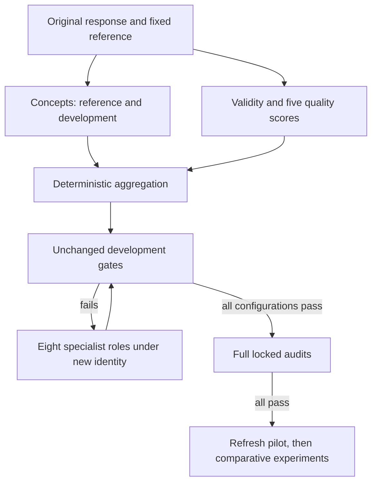

# Decomposed judging and recovery

The [registered amendment](../reports/amendments/2026-11-15-decomposed-judges.md)
defines the scientific contract. `configs/study.json` selects `judge_protocol`:
`two-stage-v1` first, `specialists-v1` only after a documented development failure.
Both use `prompts/rubric-v8.txt` plus the versioned stage instructions. Historical
v7 is retained as `Judge(..., protocol="legacy")`; it is not the active instrument.



The fallback runs validity, reference, development, and five isolated criterion
roles. Development receives only the proposed reference addition, marked untrusted;
other calls never receive another role's opinion. The sequence makes at most one
accepted finding per role, with three bounded attempts for output/transport errors.
It does not vote, reroll semantic judgments, or select favorable responses.

`Judge.assess` still returns `Assessment`. Raw findings live in `judgment_stages`;
`judgment_pipelines` maps a final cache key to its role keys. Both tables are backed
up with the existing judge-cache checkpoint. Successful stages survive an interrupted
later stage. New identities never reuse old stage/final caches. Each role emits
started, accepted/cache-hit, and failure events, full model streams, and latency.
Adjacent `*.judge-progress.json` records feed the local dashboard.

For the selected configuration, use the existing CLI:

```bash
bash scripts/run.sh calibrate --role training_judge --variant quoted --split dev --restart-development
bash scripts/run.sh calibrate --role training_judge --variant rubric --split dev --restart-development
bash scripts/run.sh calibrate --role evaluation_judge --variant quoted --split dev --restart-development
```

Run the next configuration only after the previous one completely passes. The
evaluation server must be loaded separately as described in the runbook. On an
unchanged interruption, rerun the same command without `--restart-development`.
Changing the selected protocol requires publishing the activation and using
`--restart-development` for each configuration; this archives previous evidence.
The flag cannot reset an audit. Run the same three configurations with
`--split audit` only after all development suites pass; code enforces that gate.

Exact excerpts and dependency declarations are fallible semantic assessments.
One valid brief connection earns the modest level without an extra consequence;
code requires additional declared evidence for higher levels. An issue must identify
an essential unsupported claim or a contradiction, not lack of novelty or elegance.
Both raw findings and the derived combined scores remain available for inspection.
