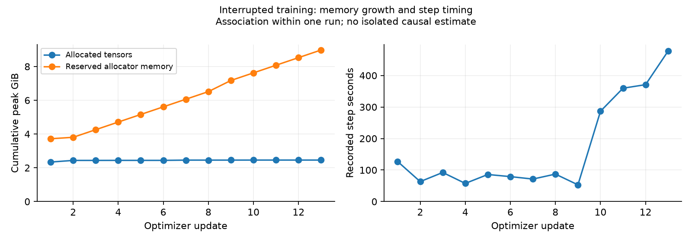

# Interrupted training: CUDA allocator growth

The exploratory-small-gpu-v2-theory-seed42 attempt stopped at optimizer boundary 13 with peak allocated/reserved policy memory 2.46/8.98 GiB. The pinned generated configuration's cache-clearing interval was 250 steps. Checkpoint state and partial outputs are preserved. This is an incomplete execution attempt, not a completed comparison or evidence that mathematical performance improved or worsened.

| Update | Step seconds | Peak allocated GiB | Peak reserved GiB |
|---|---|---|---|
| 1 | 127.00 | 2.34 | 3.72 |
| 2 | 63.28 | 2.44 | 3.81 |
| 3 | 92.28 | 2.44 | 4.26 |
| 4 | 57.53 | 2.44 | 4.71 |
| 5 | 85.86 | 2.44 | 5.16 |
| 6 | 79.11 | 2.44 | 5.61 |
| 7 | 71.37 | 2.46 | 6.06 |
| 8 | 87.11 | 2.46 | 6.51 |
| 9 | 53.05 | 2.46 | 7.17 |
| 10 | 286.59 | 2.46 | 7.62 |
| 11 | 359.67 | 2.46 | 8.08 |
| 12 | 370.88 | 2.46 | 8.53 |
| 13 | 477.39 | 2.46 | 8.98 |

Source: [saved execution evidence](../development/feasibility-small-gpu-v2-cache-growth.json). Steps have different sampled completions and judge workloads. Peaks are cumulative within the policy process and exclude the separate judge's allocator. No OOM or isolated causal mechanism is established by this trajectory.

[Preserved checkpoints and full logs](https://huggingface.co/datasets/BurnyCoder/grothendieck-rlvr/tree/main/runs/exploratory-small-gpu-v2-theory-seed42) include optimizer, scheduler, RNG, data position and judge-cache state.

The [registered development intervention](../amendments/2026-11-16-cuda-cache-diagnostic.md) tests the existing Trainer cache-release option. Its updates are discarded. No comparative configuration is silently changed.
